# AurumCast — India gold rates, monitor & forecast

**Live dashboard → [https://jsankr.github.io/AurumCast/](https://jsankr.github.io/AurumCast/)**

*Aurum* is Latin for gold (chemical symbol **Au**); AurumCast = gold + forecast.

AurumCast tracks the international (COMEX) gold price hour by hour and converts it into Indian rates per gram for **24K 99.99%, 24K 99.9%, MCX 995 and 22K**. It forecasts the next MCX open and close with likely ranges and **publishes a backtest of how well those forecasts have actually done**. A GitHub Action refreshes the numbers below every morning at about 07:47 IST. Nothing is published unless every validation check passes.

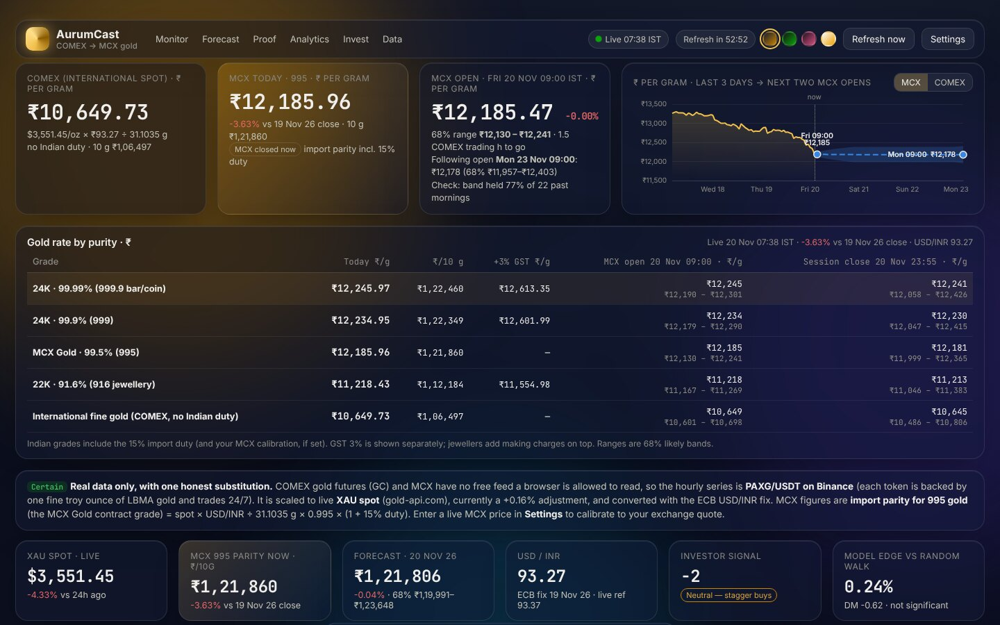

<!-- RATES:START -->
**Latest: 2026-11-20 07:41 IST** · spot $3557.12/oz · USD/INR 93.27 · duty 15% · [full report](reports/2026-11-20.md)

| Grade | Today ₹/g | ₹/10 g | + 3% GST ₹/g | MCX open 11-20 09:00 IST · ₹/g (68%) | Session close 11-20 23:55 IST · ₹/g (68%) |
|---|---:|---:|---:|---:|---:|
| 24K · 99.99% (999.9) | **₹12,265.52** | ₹1,22,655 | ₹12,633.49 | ₹12,265 (₹12,209–₹12,321) | ₹12,260 (₹12,077–₹12,446) |
| 24K · 99.9% (999) | **₹12,254.48** | ₹1,22,545 | ₹12,622.11 | ₹12,254 (₹12,198–₹12,310) | ₹12,249 (₹12,066–₹12,435) |
| MCX Gold · 99.5% (995) | **₹12,205.41** | ₹1,22,054 | — | ₹12,205 (₹12,149–₹12,261) | ₹12,200 (₹12,018–₹12,385) |
| 22K · 91.6% (916) | **₹11,236.34** | ₹1,12,363 | ₹11,573.43 | ₹11,236 (₹11,185–₹11,287) | ₹11,232 (₹11,064–₹11,402) |
| International fine (COMEX, no Indian duty) | **₹10,666.74** | ₹1,06,667 | — | ₹10,666 (₹10,618–₹10,715) | ₹10,662 (₹10,503–₹10,824) |
<!-- RATES:END -->

> **Read this first.** The forecast's *ranges* are reliable: about 68% of real outcomes land inside the 68% band. The *point* forecast (the single number) is **not** reliably better than "tomorrow = today". Use AurumCast to size the likely move and to time staggered buying, not to bet on direction. Not investment advice.

---

## Contents

1. [Rates by purity (top of page)](#1-rates-by-purity)
2. [Hour-by-hour monitor](#2-hour-by-hour-monitor)
3. [Next-session forecast & projection cone](#3-next-session-forecast--projection-cone)
4. [Proof: walk-forward backtest](#4-proof-walk-forward-backtest)
5. [Analytics](#5-analytics)
6. [Investor view](#6-investor-view)
7. [Themes](#7-themes)
8. [Data sources & formulas](#8-data-sources--formulas)
9. [Daily GitHub job & validation](#9-daily-github-job--validation)
10. [How to consider these numbers](#10-how-to-consider-these-numbers)

All screenshots and animations below are real captures of the dashboard on 20 Nov 2026, around 07:38 IST, with live data. The numbers in them are a snapshot; the live page and the table above show today's.

---

## 1. Rates by purity

### Per-gram tiles and mini forecast graph

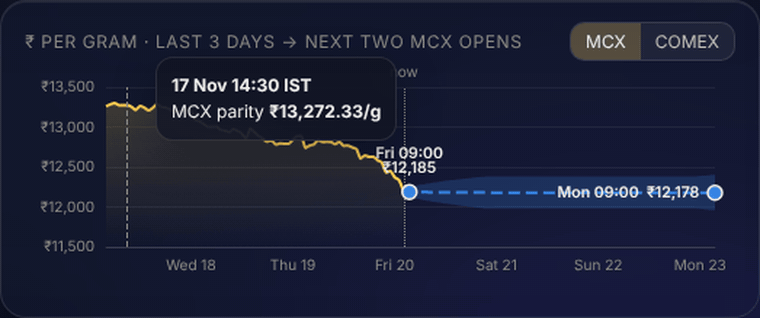

| | |
|---|---|
| **What** | Four tiles: **COMEX in ₹/g** (international price, no Indian duty), **MCX today ₹/g** (995 purity, duty included), **next MCX open ₹/g** with its 68% range and the following open, and a mini graph of the last 3 days plus a dashed forecast to the next two MCX opens. |
| **Why** | Answers "what is gold worth per gram right now, and where will MCX likely open?" at a glance. The flat stretch over the weekend is deliberate: COMEX is shut then, so no new uncertainty builds up. |
| **Source** | XAU spot (gold-api.com) × USD/INR (ECB via Frankfurter); 3-day history from Binance PAXG hourly bars. |
| **How to read** | Hover anywhere on the graph to see the ₹/g value and the 68% range at that moment. Switch **MCX / COMEX** to compare the Indian price with the international one. The gap between them is the 15% import duty and the purity difference. |

### Gold rate by purity

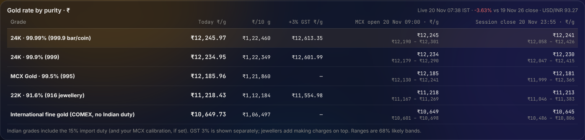

| | |
|---|---|
| **What** | ₹/g and ₹/10 g for each grade, ₹/g with 3% GST, and the forecast (with 68% range) for the next MCX open and the session close. |
| **Why** | Jewellers quote 22K and 24K; MCX quotes 995; coins and bars are 999.9. One table puts them all on the same basis. |
| **Source** | Same inputs as the tiles; purity factors 0.9999 / 0.999 / 0.995 / 0.916. |
| **How to read** | "Today" is the import-parity price, not any particular jeweller's board rate. Shops add making charges and their own margin on top of the GST column. If you enter your broker's live MCX price in **Settings**, every grade is shifted by the same calibrated premium or discount. |

### Headline numbers

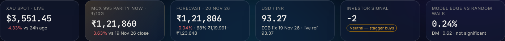

| | |
|---|---|
| **What** | Live XAU spot, MCX 995 parity per 10 g, next-close forecast, USD/INR, the investor score, and the model's edge over a random walk. |
| **Why** | The six numbers that matter most, all on one row. |
| **How to read** | The last tile is the most important one: if it says *not significant*, treat the forecast's direction as a coin flip and rely on its range. |

---

## 2. Hour-by-hour monitor

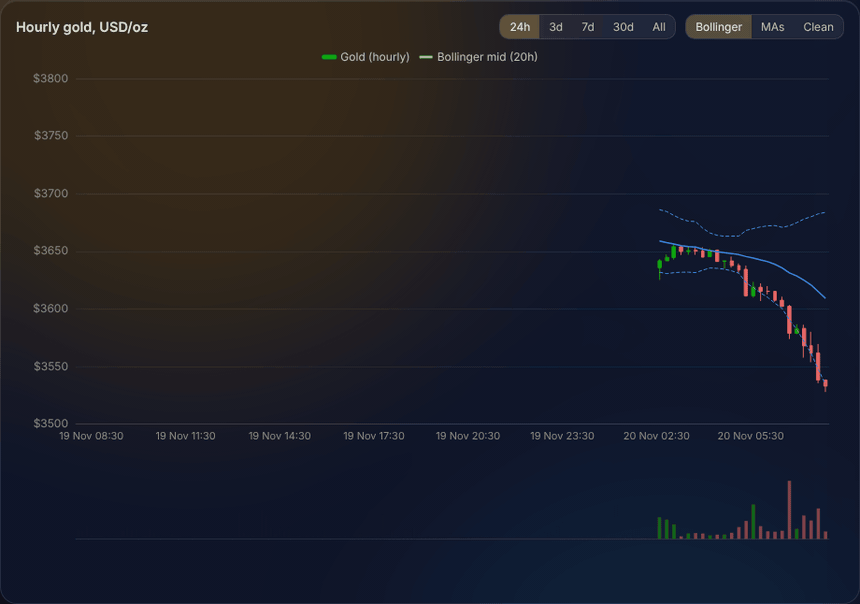

| | |
|---|---|
| **What** | Hourly gold candles (USD/oz, IST time axis) with Bollinger bands (20 h) or 20 h / 50 h moving averages, plus volume. Ranges: 24 h, 3 d, 7 d, 30 d, all. |
| **Why** | Indian prices react overnight to COMEX. This chart shows exactly when the moves happened. |
| **Source** | Binance PAXG/USDT 1-hour klines, scaled to XAU spot. Volume is PAXG volume, not COMEX volume. |
| **How to read** | A candle closing outside the Bollinger band is a stretched move. A run of candles hugging the lower band is a persistent sell-off. Scroll or pinch to zoom. |

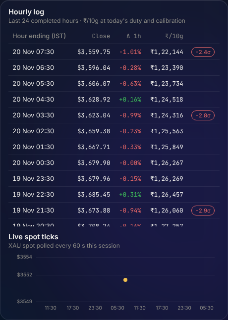

**Hourly log.** The last 24 completed hours, with close, % change and ₹/10 g MCX parity. A red or green **σ tag** marks any hour that moved more than 2× its normal hourly volatility (EWMA). The page also shows a toast alert when such an hour happens.

---

## 3. Next-session forecast & projection cone

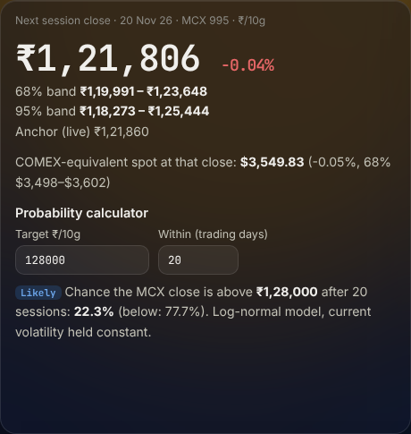

| | |
|---|---|
| **What** | The forecast MCX 995 close for the next session (₹/10 g) with 68% and 95% bands, the COMEX-equivalent spot, and a probability calculator ("chance the close is above ₹X within N sessions"). |
| **Why** | Gives a realistic range for planning a buy or a stop, instead of a single number that will almost certainly be wrong. |
| **Source** | Ensemble of 6 models (below) on the rupee gold series; bands from EWMA volatility (λ = 0.94). |
| **How to read** | The horizon counts only the hours COMEX actually trades, so a Friday-evening forecast for Monday doesn't count the weekend twice. The probability calculator assumes log-normal moves at today's volatility. |

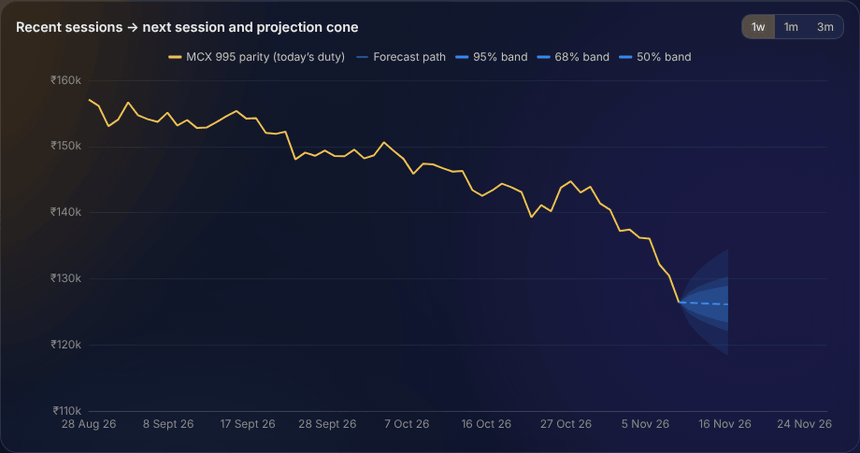

**Projection cone (1 week / 1 month / 3 months).** The 50%, 68% and 95% bands widen with √time around the 250-day drift. **This is a range of plausible outcomes, not a target.** Hover over any future date to see its ranges. A wide cone means high uncertainty; that is the honest answer when volatility is high.

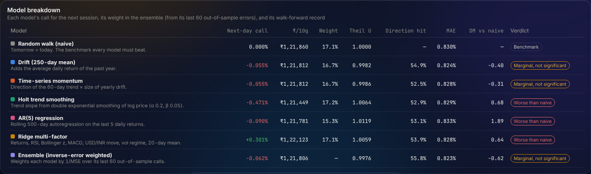

**Model breakdown.** Every model's call for the next session, its ensemble weight (from its last 60 out-of-sample errors), and its full walk-forward record:

| Model | Idea |
|---|---|
| Random walk (naive) | Tomorrow = today. The benchmark. |
| Drift | Adds the past year's average daily return. |
| Time-series momentum | Sign of the 60-day trend × size of the yearly drift. |
| Holt trend | Trend slope from double exponential smoothing. |
| AR(5) | Rolling 500-day regression on the last 5 returns. |
| Ridge multi-factor | Returns, RSI, Bollinger z, MACD, USD/INR move, volatility regime, 20-day mean. |
| **Ensemble** | Inverse-error weighted blend of all the above. |

The **verdict** column uses the Diebold-Mariano test: a model only earns "beats naive" if the improvement is statistically significant (DM below −1.96).

---

## 4. Proof: walk-forward backtest

Every model is re-run day by day over about 990 past sessions. Each day it sees **only the data that existed that evening**, then it is scored against the real next close. A unit test enforces this: it changes future prices and asserts that no past prediction moves.

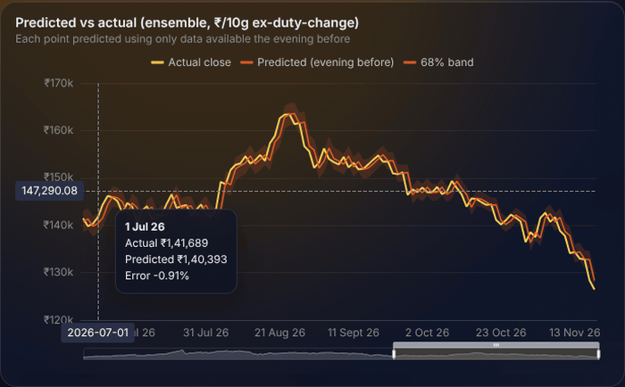

**Predicted vs actual.** The orange line is what the ensemble predicted the evening before; the gold line is what actually happened; the shaded area is the 68% band. Hover to see each day's error.

| Model accuracy vs random walk | Direction hit rate (rolling 60) |
|---|---|
| 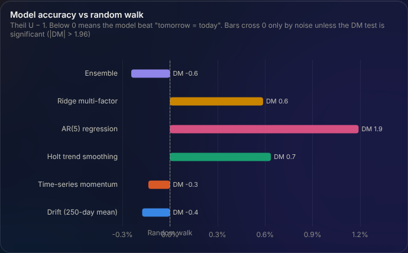 | 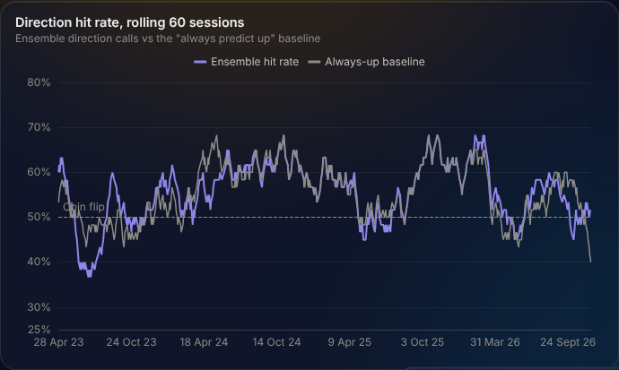 |
| Theil U − 1 for each model. Below 0 means it beat "no change". The DM label tells you whether the difference is real or noise. | The ensemble's direction calls vs simply always saying "up". Gold's upward drift makes "always up" a tough baseline. |

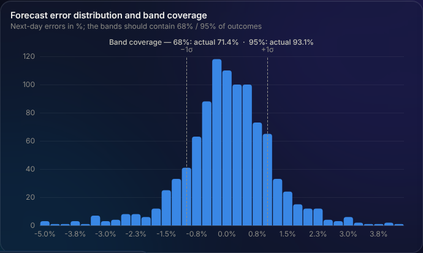

**Error distribution & coverage.** Histogram of next-day errors with the ±1σ lines. The title shows how often the 68% and 95% bands actually held. About 71% and 93% means the bands are well calibrated, with slightly fat tails.

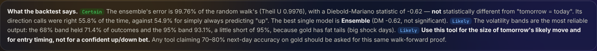

---

## 5. Analytics

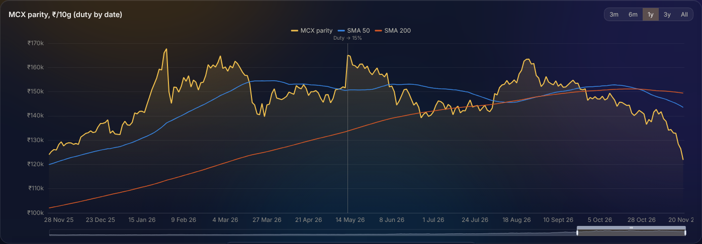

**MCX 995 parity history (₹/10 g).** Daily history with **India's import-duty regime applied by date** (10.75% → 15% → 6% → 15%; the dotted lines mark the changes), plus 50- and 200-day averages. The jump in May 2026 is the duty hike, not a gold rally.

| RSI (14) & MACD | Drawdown & volatility |
|---|---|
| 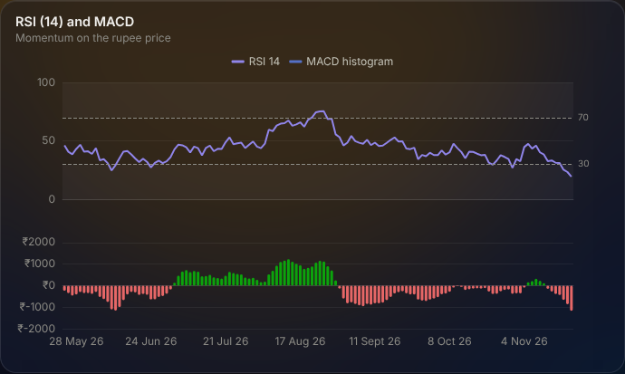 | 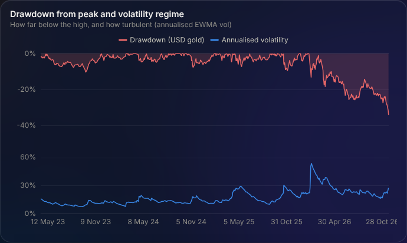 |
| RSI below 30 = oversold, above 70 = overbought. MACD histogram bars show momentum turning. | How far gold is below its peak, and how turbulent it is (annualised EWMA volatility). High volatility = wider ranges = smaller, staggered buys. |

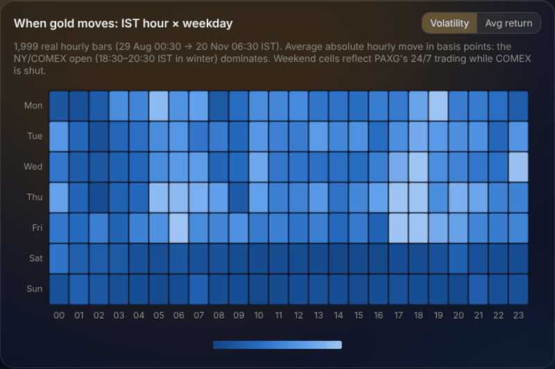

**When gold moves (IST hour × weekday).** Built from about 2,000 real hourly bars. **Volatility** mode shows the busiest hours: the New York / COMEX open around 18:30–20:30 IST in winter dominates. **Average return** mode is mostly noise unless a cell holds many bars. Weekend cells reflect PAXG trading 24/7 while COMEX is shut.

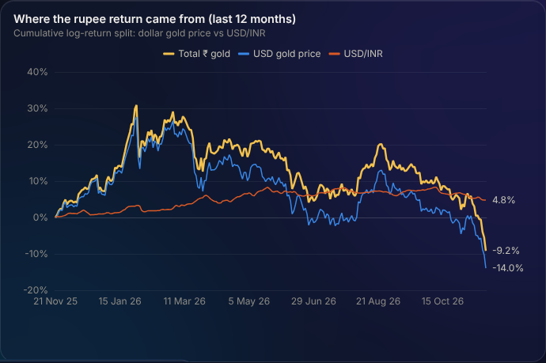

**Where the rupee return came from (12 months).** The total ₹ gold return split into the dollar gold price and USD/INR. A weakening rupee adds to Indian gold returns even when COMEX is flat.

---

## 6. Investor view

| Composite score | Factor breakdown |
|---|---|
| 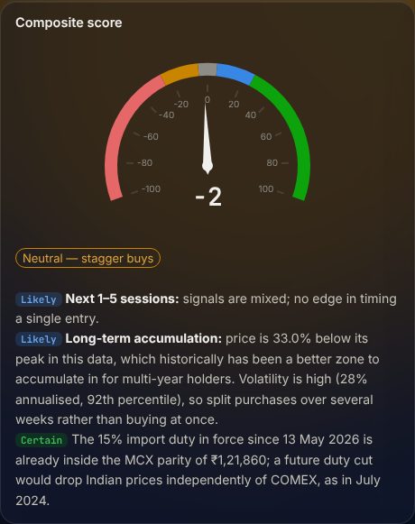 | 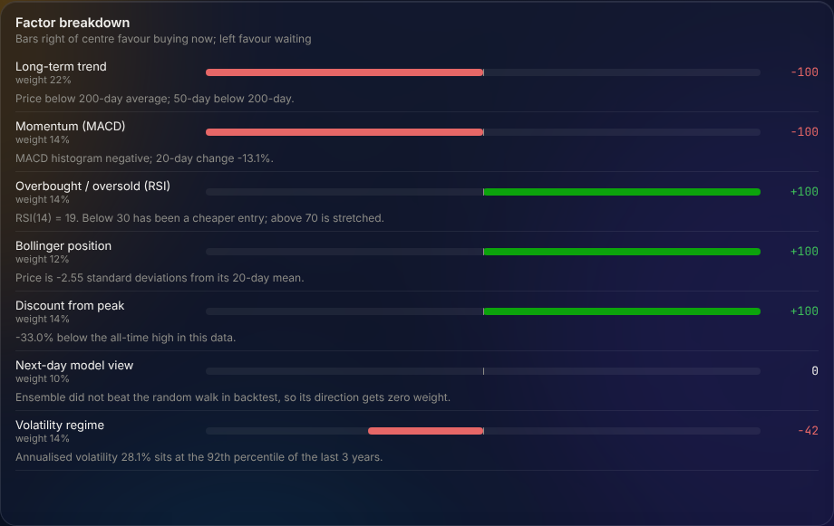 |

| | |
|---|---|
| **What** | A −100 … +100 score from 7 weighted factors: long-term trend, MACD momentum, RSI, Bollinger position, discount from peak, model view (zero weight unless the backtest proves skill), and volatility regime. |
| **Why** | Puts the main signals into one transparent number, with every factor's reason written out. |
| **How to read** | ≥ +25 accumulate · +5…+25 accumulate gradually · −5…+5 neutral, stagger buys · −25…−5 wait or buy small tranches · ≤ −25 wait for stabilisation. Read the factor text, not just the score. |

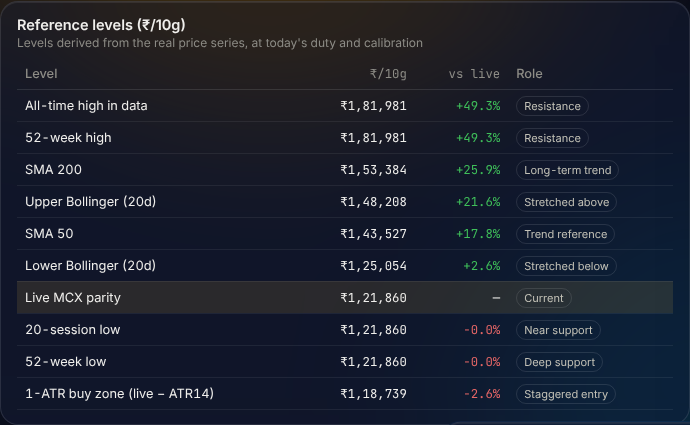

**Reference levels (₹/10 g).** Levels taken from the real price series: all-time and 52-week highs and lows, the 50- and 200-day averages, the Bollinger bands, the 20-session low, and a 1-ATR staggered-entry zone. Each shows its % distance from the live price.

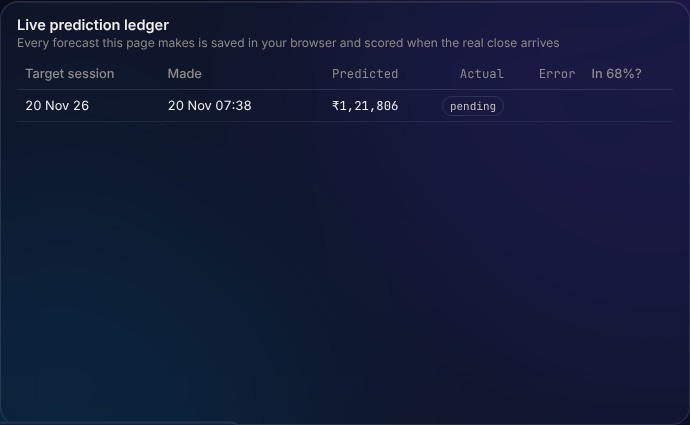

**Live prediction ledger.** Every forecast the page makes is saved in your browser and scored when the real close arrives. The daily GitHub job keeps a public version in `docs/predictions.json`.

---

## 7. Themes

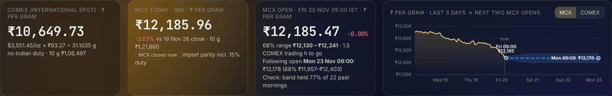

Four glass themes: **Aurum Night**, **Obsidian**, **Rose Quartz** and **Ivory Glass** (light). Your choice is remembered in your browser. Chart colours come from a colour-blind-checked palette in every theme.

---

## 8. Data sources & formulas

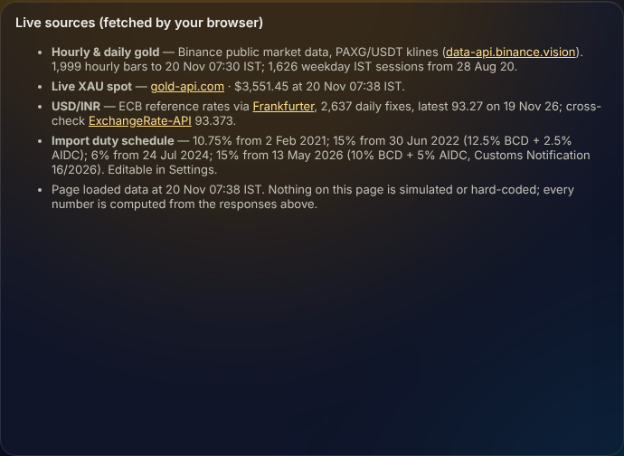

| Data | Source | Notes |
|---|---|---|
| Gold, hourly / 30-min / daily | [Binance public market data](https://data-api.binance.vision), PAXG/USDT | 1 PAXG = 1 fine troy oz of LBMA gold, trades 24/7. Used because COMEX and MCX have no free feed a browser can read. |
| Live gold spot | [gold-api.com](https://gold-api.com) XAU | Used to scale PAXG to spot (typically ±0.1–0.5%). |
| USD/INR | ECB reference rates via [Frankfurter](https://frankfurter.dev) | Cross-checked against [ExchangeRate-API](https://www.exchangerate-api.com). |
| Import duty | Customs Notification 16/2026 | 10% BCD + 5% AIDC = 15% from 13 May 2026. Set in `config.json`. |

**Formulas (₹ per gram)**

```
fine international  = spot $/oz × USD/INR ÷ 31.1034768
fine landed (India) = fine international × (1 + duty) × (1 + MCX calibration)
24K 99.99%          = fine landed × 0.9999
24K 99.9%           = fine landed × 0.999
MCX Gold (995)      = fine landed × 0.995      (MCX quotes per 10 g)
22K (916)           = fine landed × 0.916
+GST                = × 1.03                   (making charges not included)
```

MCX prices include import duty and exclude GST. MCX trades 09:00 to 23:30 IST (US summer) or 23:55 IST (US winter), Monday to Friday. Exchange holidays are not modelled.

---

## 9. Daily GitHub job & validation

`.github/workflows/daily.yml` runs every day at **02:17 UTC (07:47 IST)**. You can also start it with **Actions → Daily gold rates → Run workflow**.

1. **Unit tests** (`node --test`, 19 tests): indicators, ridge solver, purity maths, US daylight-saving, COMEX/MCX clocks, horizon scaling, morning-open pairing, and **no-look-ahead**.
2. **Fetch** all sources, with retries.
3. **Validation gate**: about 32 checks, including:
   - every source answered and is fresh;
   - spot agrees with PAXG within 2%, and the ECB rate agrees with a live USD/INR rate within 1%;
   - every grade, recomputed independently, matches;
   - grade ordering is correct;
   - forecast bands are ordered and every number is finite;
   - volatility is within sane limits;
   - backtest band coverage is within sane limits;
   - the change since the last publish is within 10%.

   **If any check fails, the job stops, nothing is committed, and GitHub emails you.**
4. **Publish**: `reports/YYYY-MM-DD.md`, `docs/latest.json`, `docs/history.csv`, `docs/predictions.json` (past predictions are scored automatically), and the rates table at the top of this README.

Run it locally:

```bash
node --test                        # unit tests
node scripts/daily.mjs --dry-run   # fetch + validate + preview the report; writes nothing
node scripts/daily.mjs             # fetch + validate + publish
node scripts/build-dashboard.mjs   # rebuild docs/index.html from src/
```

**One-time setup:** go to Settings → Pages → *Deploy from a branch* → `main` / `/docs`. The dashboard then goes live at **https://jsankr.github.io/AurumCast/**.

---

## 10. How to consider these numbers

- **Trust the ranges, not the point.** The 68% band has held about 71% of real closes and about 77% of MCX morning opens. The single forecast number has *not* beaten "no change" with statistical significance.
- **The overnight gap is already known by morning.** COMEX trades while MCX is shut, so at 07:47 IST most of the MCX opening move has already happened. The "today" rate reflects it.
- **Duty changes move Indian prices on their own.** A duty cut (like July 2024) lowers Indian rates instantly, whatever COMEX does.
- **Jeweller rates will differ.** Shops add GST, making charges and margin; city rates vary slightly. Use the 24K / 22K rows as a fair-value reference when you negotiate.
- **MCX ≠ parity.** Futures trade at a small premium or discount (carry, demand, contract month). Calibrate once in Settings with your broker's quote.
- **Staggered buying beats timing.** When the investor score is near zero or volatility is high, split purchases over several weeks.
- **Shocks aren't modelled.** Fed surprises, RBI action, duty changes and geopolitical events cause the largest days; that is why the 95% band exists.

*Not investment advice. MCX futures are leveraged and can lose more than the margin.*
